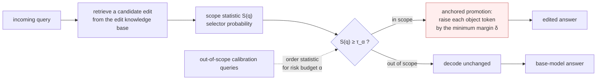

<div align="center">

# CAPE
### *Risk-Controlled Lifelong Knowledge Editing: Anchored Promotion with a Distribution-Free Locality Guarantee*

[](LICENSE)
[](requirements.txt)

</div>

---

## Overview

Lifelong knowledge editing keeps a deployed language model's facts current without retraining
it. The retrieval-based editors that do this (SERAC, GRACE, IKE, LightEdit) share one skeleton:
**retrieve** a candidate edit from a knowledge base of edits, **gate** whether the incoming
query falls in that edit's scope, and **apply** an intervention at decode time that makes the
retrieved fact the model's answer. Each of them sets the gate with a fixed threshold on a
learned score, with no stated bound on how often an out-of-scope query is edited by mistake.

**CAPE** (Conformal Anchored-Promotion Editing) keeps the retrieve-gate-apply skeleton and
changes the last two steps.

**The gate.** The scope statistic $S(q)$ of a query is the selector's probability that the
retrieved edit applies to it. Given $n$ held-out out-of-scope calibration queries with
statistics $S_1 \le \dots \le S_n$ and a locality risk budget $\alpha$, the threshold is the
order statistic

$$\tau_\alpha \;=\; S_{\left(\lceil (n+1)(1-\alpha) \rceil\right)},$$

and the gate accepts $q$ when $S(q) \ge \tau_\alpha$. For exchangeable queries, an
out-of-scope query is then accepted with probability at most $\alpha$, whatever the
distribution of the scores.

**The apply step.** For an accepted query, let $(v_0, \dots, v_{m-1})$ be the retrieved
object's tokens and $s_t$ the model's logits at decode step $t$. Within a promotion window $w$,
each object token is raised by the smallest amount that puts it ahead of every other token:

$$s'_t[v_t] \;=\; \max\Big(\, s_t[v_t],\ \max_{v \neq v_t} s_t[v] + \delta \,\Big), \qquad t < \min(w, m),\ \ \delta > 0.$$

A token that already leads is left unchanged. Because the intervention is exactly large enough,
whether a query is edited is decided by the gate alone. The prior suppression of the editor CAPE
builds on is switched off. No model weight changes at any point.



The settings every reported run uses:

| Setting | Value |
|---|---|
| promotion window $w$ | 8 |
| margin $\delta$ | 0.5 |
| retrieval depth | 5 |
| scope selector | XLM-R-large, the selector network of the editor CAPE builds on |
| threshold $\tau_\alpha$ | calibrated per dataset on its own out-of-scope training queries, never on test data |

## Getting started

### 01. Setup

```bash
pip install -r requirements.txt
export HF_TOKEN=...              # a hub token with access to the gated backbones
```

The scripts need a CUDA device and work under `/workspace`. Each one clones the editor CAPE
builds on, [LightEdit](https://github.com/ekgus9/LightEdit), into `/workspace/LightEdit`,
patches it at run time and downloads the backbone. The first run trains the scope selector
(XLM-R-large, one epoch, seed 42) and caches it in `/workspace/selector_cache`; later runs
reuse it.

### 02. The main evaluation

`src/cape_gptj.py` and `src/cape_llama.py` evaluate CAPE at a knowledge base of 1,000 edits on
ZSRE, CounterFact and RIPE, for each backbone; `src/conformal_threshold.py` fits $\tau_\alpha$ on the
calibration split alone:

```bash
python src/conformal_threshold.py
python src/cape_gptj.py          # GPT-J-6B
python src/cape_llama.py         # Llama-3.1-8B-Instruct
```

### 03. The other experiments

```bash
# stability over seeds 42, 43 and 44
python scripts/run_seeds_cf_gptj.py
python scripts/run_seeds_cf_llama.py
python scripts/run_seeds_zsre_gptj.py
python scripts/run_seeds_zsre_llama.py

# the apply step against the gate
python scripts/run_component_ablation.py      # promotion against suppression, crossed with the threshold
python scripts/run_suppression_sweep.py       # suppression over a grid of fixed thresholds

# the guarantee
python scripts/run_coverage.py                # requested alpha against the observed false-accept rate
python scripts/run_score_overlap.py           # overlap of in-scope and out-of-scope scores
python scripts/run_pareto_roc.py              # the Reliability-Locality frontier

# deployment
python scripts/run_deployment_safety.py       # out-of-scope corruption with the editor always on
python scripts/run_wrapper_capability.py      # general capability through the full editor
python scripts/run_gate_capability.py         # how often the gate rejects capability queries
python scripts/run_general_capability.py      # general capability with the LM Evaluation Harness
python scripts/run_locality_safety.py         # the editing-locality boundary case
python scripts/run_gate_realism.py            # worst-case accuracy bound on accepted queries

# the benchmark
python scripts/run_ripe_hard_null.py          # RIPE with its Relation_Specificity queries restored
```

### Packages, models and data

Python 3.11. `torch` and `transformers` are pinned: the decode-time intervention targets this
`transformers` API.

| Package | Version | Used for |
|---|---|---|
| `torch` | 2.5.1 | model execution and the decode-time logit intervention |
| `transformers` | 4.46.3 | GPT-J and Llama loading, the patched logits processor |
| `sentence-transformers` | ≥2.2 | the scope-selector encoder |
| `rank-bm25` | ≥0.2 | lexical retrieval over the edit knowledge base |
| `scikit-learn` | ≥1.3 | conformal quantiles, ROC and overlap statistics |
| `datasets` | ≥2.19 | ZSRE, CounterFact, RIPE, MMLU and CSQA |
| `accelerate` | ≥0.30 | device placement |
| `huggingface_hub` | ≥0.24 | model and selector-checkpoint download |
| `lm-eval` | 0.4.5 | `scripts/run_general_capability.py` only |

| | |
|---|---|
| Backbones | `EleutherAI/gpt-j-6B`, `meta-llama/Llama-3.1-8B-Instruct` |
| Editing benchmarks | ZSRE, CounterFact, RIPE, scored by their official implementation |
| Capability benchmarks | MMLU, CSQA, ANLI, TriviaQA |
| Knowledge base | 1,000 edits for the main and deployment runs, 300 for the seed runs |
| Risk budgets | $\alpha \in \{0.01, 0.02, 0.05, 0.10\}$; the fixed threshold LightEdit uses is 0.5 |
| Coverage protocol | calibration and evaluation on disjoint test folds of 150 queries each |

## Repository structure

```
CAPE/
├── src/
│   ├── cape_gptj.py                  # CAPE on GPT-J-6B, knowledge base of 1,000 edits
│   ├── cape_llama.py                 # CAPE on Llama-3.1-8B-Instruct, knowledge base of 1,000 edits
│   └── conformal_threshold.py        # tau_alpha from the calibration split
├── scripts/
│   ├── run_seeds_cf_gptj.py          # CounterFact on GPT-J-6B, three seeds
│   ├── run_seeds_cf_llama.py         # CounterFact on Llama-3.1-8B-Instruct, three seeds
│   ├── run_seeds_zsre_gptj.py        # ZSRE on GPT-J-6B, three seeds
│   ├── run_seeds_zsre_llama.py       # ZSRE on Llama-3.1-8B-Instruct, three seeds
│   ├── run_component_ablation.py     # promotion against suppression, by threshold
│   ├── run_suppression_sweep.py      # suppression over a grid of fixed thresholds
│   ├── run_coverage.py               # requested alpha against observed false-accept
│   ├── run_score_overlap.py          # in-scope and out-of-scope score overlap
│   ├── run_pareto_roc.py             # Reliability-Locality frontier
│   ├── run_deployment_safety.py      # out-of-scope corruption rate
│   ├── run_wrapper_capability.py     # capability through the full editor
│   ├── run_gate_capability.py        # gate rejection of capability queries
│   ├── run_general_capability.py     # LM Evaluation Harness capability
│   ├── run_locality_safety.py        # editing-locality boundary case
│   ├── run_gate_realism.py           # worst-case accuracy bound
│   └── run_ripe_hard_null.py         # RIPE with its null queries restored
├── .github/workflows/ci.yml          # secret and identity scans; every script compiles
├── README.md
├── requirements.txt
├── .gitignore
└── LICENSE
```

## Implementation

CAPE is a run-time patch to the released [LightEdit](https://github.com/ekgus9/LightEdit)
code, whose retriever, scope selector, data loaders and evaluation it uses unchanged. Each
script clones that code, applies its patches, checks that every passage it replaces is present
before replacing it, and runs. The two patched points that carry CAPE are the minimum-margin
branch of `PriorSuppressionProcessor`, which implements anchored promotion, and the calibrated
threshold at the end of `select_in_scope_facts`, which implements the gate. The other patches
let the released code run on the pinned `transformers` and load GPT-J and Llama as stock
models. The editing metrics (Reliability, Generality, Locality) come from the benchmarks'
official scorer, applied unmodified to every method.

## Citation

A citation will be added here once the paper is published.

## License

Apache License 2.0; see [LICENSE](LICENSE).
